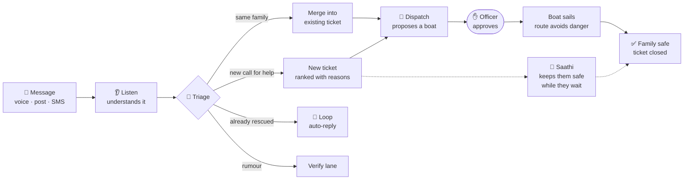

  

  
  
  

<h3 align="center">You are the duty officer on a flood night. You have three boats. Somewhere in hundreds of messages, a 68-year-old woman is waiting.</h3>

  <a href="https://vrxshxli.github.io/save-kamla/"><b>▶ Play it in your browser</b></a> · no install, no login · works on a laptop or a phone turned sideways

 

## 🌊 Why this game exists

India can send a flood alert to every phone. The SACHET system has sent over **134 billion alerts in 19+ languages**. But when people reply asking for help, it comes back as chaos: WhatsApp voice notes, posts, forwards and calls, all landing in one control room.

On a real flood night:

| What happens | What it costs |
|---|---|
| 📨 The same family is reported 5 times, in 3 languages | Nobody knows it’s one family |
| ⌨️ Volunteers hand-type each request, about **3 minutes** each | Hundreds arrive every hour |
| 🚤 Boats go to people who were **already rescued** | Someone else keeps waiting |
| 📢 Rumours (“the dam has burst!”) spread faster than facts | Panic, wasted trips |

**Pukaar** (पुकार, “a call for help”) is our idea for fixing this: a team of AI agents that turns every call for help into **one ticket**, gets it to the **right rescuer**, and **closes it** when the family is safe, with a human approving every boat.

This game lets you **feel** that difference in two minutes.

 

## 🎮 How it plays

  

The game opens with a short animated story: it’s 9:30 PM, Ward 12 is flooding, and Kamla, 68, is on the ground floor with her feverish grandson. Then you play the same night twice.

### Round 1 · The way it works today

  

- Messages pour in: voice notes in Hindi, posts in English, SMS in Hinglish, emotional reposts, rumours and questions.
- **You** read them, pick one, and press **Send a boat here**.
- Your boat sails across the live map, and you see what it finds: *“Already rescued at 8:12 PM”*, *“Lane 6 is flooded, turning back”*, *“Kamla found, after a search”*.
- Floodwater keeps rising while you decide.

### Round 2 · The same night, with Pukaar

  

- The **same messages** arrive, but now six AI agents read them first.
- Every message gets a label showing which agent handled it, and a **“What just happened”** bar explains each agent in plain words the first time it acts.
- Urgent families become **pins on the map**, ranked with reasons. Kamla’s three messages merge into one ticket (`×3`).
- When a boat is proposed, **you check the reasons and tap Approve**. That’s your whole job.

  

While Kamla waits, **Saathi**, the safety companion, walks her through a gas leak in Hindi, using only an approved safety playbook, and flags the risk to the boat crew.

### The result

  

The comparison is built from **your own choices** in each round.

 

## 🤖 Meet the agents

| | Agent | What it does in the game |
|:-:|---|---|
| 👂 | **Listen** | Understands voice notes and messages in Hindi, Marathi, Hinglish and English, and pulls out who needs help, where and how urgently |
| 🔀 | **Triage** | Merges repeat reports into one ticket, ranks tickets with reasons, and sends rumours to be checked |
| 🗺️ | **Watch** | Remembers road and power reports, so routes avoid flooded Lane 6 automatically |
| 🚤 | **Dispatch** | Proposes the right boat for each family, and never sends one without your approval |
| 🔁 | **Loop** | Tells everyone reposting about a rescued family that they’re already safe, and answers general questions |
| 🛟 | **Saathi** | Stays with the family while they wait, with safety steps from approved playbooks; danger always goes to 112 first |

 

## 🧭 How a call for help flows

 

## ⚖️ Same night, two endings

| | Round 1 · Today | Round 2 · With Pukaar |
|---|---|---|
| **Who reads every message** | You | The agents |
| **Repeat reports** | Look like new emergencies | Merged into one ticket |
| **Already-rescued reposts** | Can waste a boat | Answered automatically |
| **Rumours** | Can waste a boat | Sent to be checked |
| **Flooded roads** | Found by boats the hard way | Remembered and avoided |
| **Kamla while she waits** | Alone | Guided by Saathi |
| **Your job** | Everything | Approve three boats |

> **Agents do the paperwork. Humans send the boats.** Nothing irreversible happens without a person approving it.

 

## 🛠️ Under the hood

- **One self-contained `index.html`**: vanilla JavaScript, CSS and animated SVG. No framework, no backend, no tracking.
- **Live map** drawn in SVG, with boats animated along road routes and rising water.
- **Accessible**: keyboard friendly, respects *reduced motion*, and follows your light or dark mode.

**Run it locally:** download `index.html` and open it in any browser.

 

## 📌 Please note

This is a **scripted simulation of the Pukaar concept**, made for the AgentX Hackathon 2026 idea round so anyone can understand the problem and the idea in about two minutes. The messages, families and outcomes are **illustrative**, based on documented flood-night patterns, and all data is mock. The real multi-agent system, with live tools and human approval gates, will be built during the 24-hour hackathon round.

 

<b>📚 Sources for the facts above</b>

 

- NDMA / C-DOT on the SACHET alert system, 2026
- Khaleej Times on Kerala flood volunteers, 2018 (manual entry of rescue requests)
- Office of the Kerala Chief Minister, via The Statesman, 2018 (requests for people already rescued)
- The News Minute on lessons from the Kerala floods, 2018

 

  <b>No call for help should be heard five times and answered never.</b>  
  

